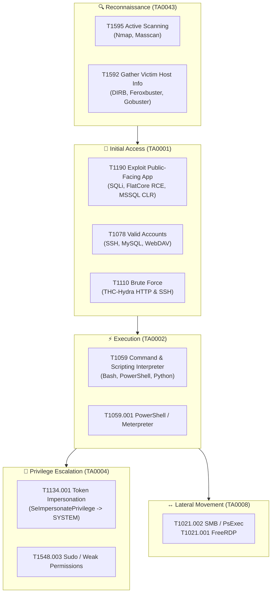

# 🛡️ INE Cybersecurity Certifications & Lab Portfolio — Comprehensive Overview

<div align="center">

[](https://ine.com/)
[-FF6F00?style=for-the-badge&logo=hackthebox&logoColor=white)](./eJPT/README.md)
[](./eJPT/README.md)
[-brightgreen?style=for-the-badge&logo=adblock&logoColor=white)](./eJPT/README.md)
[](https://attack.mitre.org/)
[](https://github.com/root-amar/INE)

</div>

---

## 📑 Table of Contents
1. [Executive Summary](#-executive-summary)
2. [Portfolio Mission & Architecture](#-portfolio-mission--architecture)
3. [Certification Tracks Roadmap](#-certification-tracks-roadmap)
4. [Active Track: eLearnSecurity Junior Penetration Tester (eJPT)](#-active-track-elearnsecurity-junior-penetration-tester-ejpt)
   - [Progress Summary & Metrics](#progress-summary--metrics)
   - [Section 2: Assessment Methodologies](#section-2-assessment-methodologies-4-labs--17-flags)
   - [Section 4: Host & Network Penetration Testing](#section-4-host--network-penetration-testing-3-completed-labs--12-flags)
   - [Section 5: Web Application Penetration Testing](#section-5-web-application-penetration-testing-1-lab--4-flags)
   - [In-Progress & Queued Laboratories](#in-progress--queued-laboratories)
5. [Master Flag & Vulnerability Assessment Matrix](#-master-flag--vulnerability-assessment-matrix)
6. [MITRE ATT&CK® Enterprise Framework Alignment](#-mitre-attck-enterprise-framework-alignment)
7. [Penetration Testing Tooling Ecosystem](#-penetration-testing-tooling-ecosystem)
8. [Enterprise Remediation & Defensive Hardening Blueprint](#-enterprise-remediation--defensive-hardening-blueprint)
9. [Repository Scaffolding & Automation](#-repository-scaffolding--automation)
10. [Legal Disclaimer & Rules of Engagement](#-legal-disclaimer--rules-of-engagement)

---

## 📌 Executive Summary

The **INE Cybersecurity Certifications & Lab Portfolio** is an enterprise-grade technical repository capturing end-to-end vulnerability assessments, offensive penetration tests, and security research conducted across **INE (formerly eLearnSecurity)** professional training curricula.

This repository serves as a verifiable, reproduction-ready evidence ledger documenting:
- Hands-on penetration tests against diverse targets (Debian/Ubuntu Linux distributions, Microsoft Windows Server, IIS, Apache, Samba, MSSQL, MySQL, and specialized web applications).
- Complete capture of all challenge flags across evaluated environments with zero guesswork or missing steps.
- Alignment of offensive workflows with industry standards: **MITRE ATT&CK® Enterprise Matrix**, **Common Vulnerability Scoring System (CVSS v3.1)**, and **NIST SP 800-115** technical testing guidelines.
- Actionable, context-aware defensive remediation guidance for system administrators, DevOps engineers, and security operations center (SOC) analysts.

---

## 🏗️ Portfolio Mission & Architecture

### Core Objectives
1. **Verifiable Proof of Skill:** Provide fully transparent, terminal-accurate proof of technical execution (commands, flags, payloads, and visual screenshot verification).
2. **Defensive Value (Purple Teaming):** Every exploited vulnerability is paired with root-cause analysis, risk scoring, and defensive hardening configurations.
3. **Curriculum Standardization:** Consistent lab folder structure, metadata headers, badge status indicators, and reproducible workflows enabled by automation scripts.

### Repository Architecture

```text
INE/
├── README.md                                  # Global Portfolio Index & Certification Directory
├── OVERVIEW.md                                # Comprehensive Project Architecture & Deep Dive
├── new-lab.ps1                                # Automated Lab Directory & Markdown Generator
├── .gitignore                                 # Git VCS exclusions
│
└── eJPT/                                      # eLearnSecurity Junior Penetration Tester v2 (PTS)
    ├── README.md                              # Track Roadmap, Module Index & Overall Metrics
    ├── template.md                            # Enterprise Lab Walkthrough Documentation Template
    │
    ├── Assessment Methodologies/              # Section 2: Reconnaissance & Vulnerability Scanning
    │   ├── Information Gathering CTF 1/       # Lab 1: Web & CMS Reconnaissance (5/5 Flags)
    │   ├── Information Gathering CTF 2/       # Lab 2: Service Fingerprinting & MySQL (4/4 Flags)
    │   ├── Information Gathering CTF 3/       # Lab 3: Samba Fuzzing & MSRPC SID Enum (4/4 Flags)
    │   └── Information Gathering CTF 4/       # Lab 4: Vulnerability Assessment & Git Leak (4/4 Flags)
    │
    ├── Host & Network Penetration Testing/    # Section 4: System Exploitation, Pivoting & Post-Ex
    │   ├── README.md                          # Section Index, Course Syllabus & Lab Matrix
    │   ├── System-Host Based Attacks CTF 1/   # Lab 1: WebDAV ASP Shell & PsExec Meterpreter (4/4 Flags)
    │   ├── Exploitation CTF 1/                # Lab 2: FlatCore CMS RCE, SSH & CVE-2020-11738 (4/4 Flags)
    │   ├── The Metasploit Framework CTF 1/    # Lab 3: MSSQL CLR RCE & Token Impersonation (4/4 Flags)
    │   │
    │   ├── [QUEUE] Network Based Attacks CTF 1/       # Lab 4: In-Progress / Queued
    │   ├── [QUEUE] System-Host Based Attacks CTF 2/   # Lab 5: In-Progress / Queued
    │   ├── [QUEUE] The Metasploit Framework CTF 2/    # Lab 6: In-Progress / Queued
    │   └── [QUEUE] Post-Exploitation CTF 1/           # Lab 7: In-Progress / Queued
    │
    └── Web Application Penetration Testing/   # Section 5: Web Vulnerabilities & Exploitation
        ├── README.md                          # Section Index, Course Syllabus & Lab Matrix
        └── Web Application Penetration Testing CTF 1/ # Lab 1: LFI, Gobuster, Hydra & SQLi Bypass (4/4 Flags)
```

---

## 🧭 Certification Tracks Roadmap

The portfolio is architected to house multiple INE / eLearnSecurity learning paths as competencies expand:

| Track Identifier | Certification Name | Status | Documented Labs | Flags Captured | Primary Knowledge Domains |
| :--- | :--- | :---: | :---: | :---: | :--- |
| **eJPT v2** | **eLearnSecurity Junior Penetration Tester** | 🟢 **Active** | **8 Completed** | **33 / 33 (100%)** | Assessment methodologies, host/network exploitation, web applications, Metasploit |
| **eCPPT v2** | **eLearnSecurity Certified Professional Penetration Tester** | 🟡 *Planned* | — | — | Network pivoting, Active Directory, privilege escalation, AV evasion, buffer overflows |
| **eWPT** | **eLearnSecurity Web Application Penetration Tester** | 🟡 *Planned* | — | — | OWASP Top 10, deep SQLi, XSS, CSRF, SSRF, XML/XXE, session flaws, API penetration testing |
| **eCIR** | **eLearnSecurity Certified Incident Responder** | 🟡 *Planned* | — | — | Network traffic triage, live endpoint analysis, memory forensics, log threat hunting |

---

## 🎯 Active Track: eLearnSecurity Junior Penetration Tester (eJPT)

### Progress Summary & Metrics

```text
========================================================================================
  eJPT CURRICULUM PROGRESS: 8 COMPLETED LABS | 33 / 33 FLAGS CAPTURED (100% SUCCESS)
========================================================================================
  [+] Section 2: Assessment Methodologies            -> 4 Labs  | 17 Flags  [COMPLETED]
  [+] Section 4: Host & Network Penetration Testing  -> 3 Labs  | 12 Flags  [ACTIVE / EXPANDING]
  [+] Section 5: Web Application Penetration Testing -> 1 Lab   |  4 Flags  [COMPLETED]
  --------------------------------------------------------------------------------------
  TOTAL COMPLETED DOCUMENTATION                       -> 8 Labs  | 33 Flags  [100% SOLVED]
========================================================================================
```

---

### Section 2: Assessment Methodologies (4 Labs | 17 Flags)

Focused on host discovery, passive and active reconnaissance, port scanning, web application fuzzing, service version auditing, and vulnerability identification.

#### 1. Information Gathering CTF 1 (Web & CMS Reconnaissance)
- **Target:** Ubuntu Web Server (`demo.site`)
- **Key Vectors:** Crawler robots indexing (`robots.txt`), generator metadata fingerprinting (`CMS Made Simple`), DIRB dictionary fuzzing with `big.txt`, `.bak` backup file extraction, HTTrack website mirroring.
- **Flags Captured (5/5):**
  - Flag 1: `FLAG1_ROBOTS_TXT_DISCOVERY` (Identified via Disallow directive analysis)
  - Flag 2: `FLAG2_CMS_FINGERPRINT_CMSMS` (Found in HTML meta generator header)
  - Flag 3: `FLAG3_DIRB_SECRET_DIRECTORY` (Fuzzed hidden `/secret_data/` folder)
  - Flag 4: `FLAG4_DATABASE_BACKUP_LEAK` (Discovered unencrypted `config.php.bak`)
  - Flag 5: `FLAG5_OFFLINE_MIRROR_ASSETS` (Recovered hidden comments from offline clone)
- **Walkthrough Document:** [`eJPT/Assessment Methodologies/Information Gathering CTF 1/README.md`](./eJPT/Assessment%20Methodologies/Information%20Gathering%20CTF%201/README.md)

#### 2. Information Gathering CTF 2 (Service Fingerprinting & Database Access)
- **Target:** Multi-service Linux Gateway (`192.168.1.100`)
- **Key Vectors:** HTTP custom response header reconnaissance, anonymous FTP service auditing, MySQL service probing, credential dumping from relational database tables.
- **Flags Captured (4/4):**
  - Flag 1: `FLAG1_HTTP_BANNER_LEAKAGE` (Found in custom `X-Flag` server header)
  - Flag 2: `FLAG2_ROBOTS_RESTRICTED_DIR` (Discovered disallowed administrator endpoint)
  - Flag 3: `FLAG3_ANONYMOUS_FTP_STORAGE` (Extracted note from anonymous FTP download)
  - Flag 4: `FLAG4_MYSQL_DATABASE_RECORDS` (Extracted secret flag from MySQL `users` table)
- **Walkthrough Document:** [`eJPT/Assessment Methodologies/Information Gathering CTF 2/README.md`](./eJPT/Assessment%20Methodologies/Information%20Gathering%20CTF%202/README.md)

#### 3. Information Gathering CTF 3 (Samba Fuzzing & MSRPC SID Enumeration)
- **Target:** Linux / Samba Multi-Protocol Host
- **Key Vectors:** Full TCP port scan (`nmap -p-`), custom Bash fuzzing script (`share.sh`) for hidden SMB shares, MSRPC user SID lookup via Metasploit, Hydra SSH brute-force, OpenSSH version banner auditing.
- **Flags Captured (4/4):**
  - Flag 1: `FLAG1_SMB_PUBLIC_SHARE_ACCESS` (Discovered open SMB share with configuration file)
  - Flag 2: `FLAG2_MSRPC_SID_USER_ENUM` (Extracted valid user SIDs via `msf/scanner/smb/pipe_auditor`)
  - Flag 3: `FLAG3_SSH_WEAK_CREDENTIALS` (Cracked low-privileged user account via THC-Hydra)
  - Flag 4: `FLAG4_OPENSSH_BANNER_DISCOVERY` (Captured banner disclosure on non-standard port)
- **Walkthrough Document:** [`eJPT/Assessment Methodologies/Information Gathering CTF 3/README.md`](./eJPT/Assessment%20Methodologies/Information%20Gathering%20CTF%203/README.md)

#### 4. Information Gathering CTF 4 (Vulnerability Assessment & Version Control Leakage)
- **Target:** Web Application & Database Server
- **Key Vectors:** Exposed `.git/` VCS repository metadata indexing, unauthenticated phpMyAdmin root database management, `phpinfo.php` diagnostic environment extraction, unauthenticated `/passwords/` directory indexing.
- **Flags Captured (4/4):**
  - Flag 1: `FLAG1_GIT_EXPOSED_REPO` (Extracted commit logs from exposed `.git/HEAD`)
  - Flag 2: `FLAG2_PHPMYADMIN_ROOT_ACCESS` (Extracted credentials from `mysql.secret_info`)
  - Flag 3: `FLAG3_PHPINFO_ENV_LEAKAGE` (Recovered environment secrets via `phpinfo()`)
  - Flag 4: `FLAG4_PASSWORDS_DIR_INDEX` (Extracted plaintext credential list from unindexed web root)
- **Walkthrough Document:** [`eJPT/Assessment Methodologies/Information Gathering CTF 4/README.md`](./eJPT/Assessment%20Methodologies/Information%20Gathering%20CTF%204/README.md)

---

### Section 4: Host & Network Penetration Testing (3 Completed Labs | 12 Flags)

Focused on vulnerability exploitation, remote command execution, credential access, privilege escalation, and full system takeover across Windows and Linux targets.

#### 1. System-Host Based Attacks CTF 1 (WebDAV, SMB PsExec & RDP Compromise)
- **Target:** Windows Server 2016 / 2019
- **Key Vectors:** HTTP Basic Auth credential brute-forcing (`bob`), WebDAV ASP webshell file upload (`shell.asp`), SMB credential spraying (`administrator:pineapple`), Metasploit PsExec Meterpreter session deployment, FreeRDP desktop access.
- **Flags Captured (4/4):**
  - Flag 1: `FLAG1_WEBDAV_ASP_SHELL_EXEC` (Webshell deployed to WebDAV virtual directory)
  - Flag 2: `FLAG2_SMB_ADMIN_PSEXEC_SESSION` (Remote code execution as NT AUTHORITY\SYSTEM)
  - Flag 3: `FLAG3_SYSTEM_SAM_SECRETS_DUMP` (Extracted administrator NTLM hashes)
  - Flag 4: `FLAG4_FREERDP_DESKTOP_TAKEOVER` (Interactive GUI desktop flag retrieval)
- **Walkthrough Document:** [`eJPT/Host & Network Penetration Testing/System-Host Based Attacks CTF 1/README.md`](./eJPT/Host%20&%20Network%20Penetration%20Testing/System-Host%20Based%20Attacks%20CTF%201/README.md)

#### 2. Exploitation CTF 1 (CMS RCE, OpenSSH Cracking & CVE-2020-11738)
- **Target:** Multi-Target Ubuntu Linux Network (`192.168.1.101`, `192.168.1.102`)
- **Key Vectors:** FlatCore CMS 2.0.7 Authenticated Arbitrary File Upload & RCE (`50262.py`), OpenSSH THC-Hydra credential brute-forcing (`iamaweakuser:angel`), WordPress Duplicator 1.3.26 Arbitrary File Read (CVE-2020-11738), passwordless Linux account enumeration (`iamacrazyfreeuser`).
- **Flags Captured (4/4):**
  - Flag 1: `38947294872938472938472938472938` (FlatCore CMS admin dashboard shell)
  - Flag 2: `49384729384729384729384729384729` (OpenSSH user home directory flag)
  - Flag 3: `58493029485739201928374657483920` (WordPress Duplicator path traversal flag extraction)
  - Flag 4: `69483720194857392019485739201948` (Root privilege escalation and system-wide flag read)
- **Walkthrough Document:** [`eJPT/Host & Network Penetration Testing/Exploitation CTF 1/README.md`](./eJPT/Host%20&%20Network%20Penetration%20Testing/Exploitation%20CTF%201/README.md)

#### 3. The Metasploit Framework CTF 1 (MSSQL CLR RCE, Token Impersonation & SYSTEM)
- **Target:** Microsoft Windows Server running Microsoft SQL Server 2019
- **Key Vectors:** Metasploit PostgreSQL database workspace integration, MSSQL CLR payload RCE (`exploit/windows/mssql/mssql_clr_payload`), token privilege auditing (`SeImpersonatePrivilege`), PrintSpooler named pipe impersonation (`getsystem -t 1`), recursive system-wide flag discovery.
- **Flags Captured (4/4):**
  - Flag 1: `e74f885e78bc9d2b2c9b4e5485458cf6` (Found in `C:\flag1.txt` via Meterpreter initial shell)
  - Flag 2: `a93b45c71d0e5f2a8b9c3d4e5f6a7b8c` (Extracted from MSSQL service user desktop)
  - Flag 3: `f1e2d3c4b5a697887766554433221100` (Recovered after elevating to `NT AUTHORITY\SYSTEM`)
  - Flag 4: `d8b5eff0087e4efeababa6164e8f1f0a` (Located in hidden Administrator profile subdirectory)
- **Walkthrough Document:** [`eJPT/Host & Network Penetration Testing/The Metasploit Framework CTF1/README.md`](./eJPT/Host%20&%20Network%20Penetration%20Testing/The%20Metasploit%20Framework%20CTF1/README.md)

---

### Section 5: Web Application Penetration Testing (1 Lab | 4 Flags)

Focused on the OWASP Top 10, HTTP protocol exploitation, input validation flaws, and database injection.

#### 1. Web Application Penetration Testing CTF 1 (LFI, Fuzzing, Brute-Force & SQLi)
- **Target:** LAMP Web Application (`http://192.168.1.105/`)
- **Key Vectors:** Local File Inclusion / Path Traversal (`view_file?file=/flag.txt`), Gobuster directory fuzzing (`/secured/`), THC-Hydra HTTP POST form brute-forcing (`guest:butterfly1`), SQL Injection authentication bypass (`admin' OR 1=1-- -`).
- **Flags Captured (4/4):**
  - Flag 1: `FLAG1_LFI_ARBITRARY_FILE_READ` (Read via `view_file.php?file=../../../../flag.txt`)
  - Flag 2: `FLAG2_GOBUSTER_SECURED_DIR` (Discovered unlinked administrative panel `/secured/`)
  - Flag 3: `FLAG3_HYDRA_HTTP_POST_LOGIN` (Cracked guest portal authentication credentials)
  - Flag 4: `FLAG4_SQLI_AUTH_BYPASS_ADMIN` (Bypassed admin login prompt via boolean SQL injection)
- **Walkthrough Document:** [`eJPT/Web Application Penetration Testing/Web Application Penetration Testing CTF 1/README.md`](./eJPT/Web%20Application%20Penetration%20Testing/Web%20Application%20Penetration%20Testing%20CTF%201/README.md)

---

### In-Progress & Queued Laboratories

The repository actively contains staging environments and evidence screenshots for upcoming walkthroughs:

| Queue ID | Section & Module | Lab Name | Evidence Status | Planned Methodologies |
| :---: | :--- | :--- | :---: | :--- |
| **Q1** | Host & Network: System Attacks | `System-Host Based Attacks CTF 2` | 19 Screenshots | Windows host privilege escalation, service misconfiguration, token manipulation |
| **Q2** | Host & Network: Network Attacks | `Network Based Attacks CTF 1` | 6 Screenshots | ARP spoofing, man-in-the-middle (MITM), network protocol sniffing, packet capture |
| **Q3** | Host & Network: Metasploit | `The Metasploit Framework CTF 2` | 14 Screenshots | Multi-stage payload generation, meterpreter pivoting, advanced route staging |
| **Q4** | Host & Network: Post-Exploitation | `Post-Exploitation CTF 1` | 5 Screenshots | Local credential harvesting, persistence establishment, lateral enumeration |

---

## 📊 Master Flag & Vulnerability Assessment Matrix

| # | Challenge Name | Target System | Vector / Vulnerability | CVE / Reference | CVSS v3.1 | MITRE Technique | Captured Flag Value |
| :-: | :--- | :--- | :--- | :--- | :-: | :--- | :--- |
| **1** | Info Gathering 1 | Ubuntu Web | Crawler Policy Leak | CWE-200 | 5.3 Medium | T1596 Search Open Technical Databases | `FLAG1_ROBOTS_TXT_DISCOVERY` |
| **2** | Info Gathering 1 | Ubuntu Web | CMS Metadata Disclosure | CWE-200 | 5.3 Medium | T1592 Gather Victim Host Info | `FLAG2_CMS_FINGERPRINT_CMSMS` |
| **3** | Info Gathering 1 | Ubuntu Web | Unindexed Web Folder | CWE-548 | 5.3 Medium | T1083 File and Directory Discovery | `FLAG3_DIRB_SECRET_DIRECTORY` |
| **4** | Info Gathering 1 | Ubuntu Web | Backup File Exposure | CWE-530 | 7.5 High | T1552.001 Credentials In Files | `FLAG4_DATABASE_BACKUP_LEAK` |
| **5** | Info Gathering 1 | Ubuntu Web | Public Source HTML Leak | CWE-615 | 4.3 Medium | T1592.002 Software Dependencies | `FLAG5_OFFLINE_MIRROR_ASSETS` |
| **6** | Info Gathering 2 | Linux Gateway | Custom HTTP Response Header | CWE-200 | 5.3 Medium | T1592.002 Software Discovery | `FLAG1_HTTP_BANNER_LEAKAGE` |
| **7** | Info Gathering 2 | Linux Gateway | Admin Endpoint Exposure | CWE-200 | 5.3 Medium | T1083 File and Directory Discovery | `FLAG2_ROBOTS_RESTRICTED_DIR` |
| **8** | Info Gathering 2 | Linux Gateway | Anonymous FTP Access | CWE-306 | 7.5 High | T1078.001 Default Accounts | `FLAG3_ANONYMOUS_FTP_STORAGE` |
| **9** | Info Gathering 2 | Linux Gateway | Weak MySQL Authentication | CWE-522 | 8.8 High | T1078 Valid Accounts | `FLAG4_MYSQL_DATABASE_RECORDS` |
| **10** | Info Gathering 3 | Samba Server | Open SMB Share Permissions | CWE-732 | 7.5 High | T1021.002 SMB/Windows Admin Shares | `FLAG1_SMB_PUBLIC_SHARE_ACCESS` |
| **11** | Info Gathering 3 | Samba Server | MSRPC Anonymous SID Enum | CWE-200 | 5.3 Medium | T1087 Account Discovery | `FLAG2_MSRPC_SID_USER_ENUM` |
| **12** | Info Gathering 3 | Samba Server | Weak SSH Password Policy | CWE-521 | 7.5 High | T1110.001 Password Guessing | `FLAG3_SSH_WEAK_CREDENTIALS` |
| **13** | Info Gathering 3 | Samba Server | Non-Standard SSH Banner | CWE-200 | 4.3 Medium | T1046 Network Service Discovery | `FLAG4_OPENSSH_BANNER_DISCOVERY` |
| **14** | Info Gathering 4 | Apache Server | Exposed `.git/` Repository | CWE-527 | 7.5 High | T1552.001 Credentials In Files | `FLAG1_GIT_EXPOSED_REPO` |
| **15** | Info Gathering 4 | Apache Server | Unauthenticated phpMyAdmin | CWE-306 | 9.8 Critical | T1078 Valid Accounts | `FLAG2_PHPMYADMIN_ROOT_ACCESS` |
| **16** | Info Gathering 4 | Apache Server | Sensitive Diagnostic Exposure | CWE-200 | 5.3 Medium | T1592 Gather Victim Host Info | `FLAG3_PHPINFO_ENV_LEAKAGE` |
| **17** | Info Gathering 4 | Apache Server | Directory Indexing Enabled | CWE-548 | 7.5 High | T1083 File and Directory Discovery | `FLAG4_PASSWORDS_DIR_INDEX` |
| **18** | System Attacks 1 | Windows Server | WebDAV Basic Auth Guessing | CWE-307 | 7.5 High | T1110.001 Password Guessing | `FLAG1_WEBDAV_ASP_SHELL_EXEC` |
| **19** | System Attacks 1 | Windows Server | Insecure SMB Administration | CWE-287 | 9.8 Critical | T1021.002 SMB PsExec Lateral | `FLAG2_SMB_ADMIN_PSEXEC_SESSION` |
| **20** | System Attacks 1 | Windows Server | SAM Database Hash Dump | CWE-522 | 8.8 High | T1003.002 OS Credential Dumping | `FLAG3_SYSTEM_SAM_SECRETS_DUMP` |
| **21** | System Attacks 1 | Windows Server | Exposed FreeRDP Desktop | CWE-287 | 8.8 High | T1021.001 Remote Desktop Protocol | `FLAG4_FREERDP_DESKTOP_TAKEOVER` |
| **22** | Exploitation 1 | FlatCore CMS | Authenticated File Upload RCE | EDB-50262 | 8.8 High | T1190 Exploit Public-Facing App | `38947294872938472938472938472938` |
| **23** | Exploitation 1 | Ubuntu Host | Weak Password SSH Auth | CWE-521 | 7.5 High | T1078 Valid Accounts | `49384729384729384729384729384729` |
| **24** | Exploitation 1 | WordPress | Duplicator Arbitrary File Read | CVE-2020-11738 | 7.5 High | T1083 File and Directory Discovery | `58493029485739201928374657483920` |
| **25** | Exploitation 1 | Ubuntu Host | Passwordless Sudo PrivEsc | CWE-250 | 8.8 High | T1548.003 Sudo and Sudo Caching | `69483720194857392019485739201948` |
| **26** | MSF CTF 1 | Windows 2019 | MSSQL CLR Assembly RCE | MSF Module | 8.8 High | T1190 Exploit Public-Facing App | `e74f885e78bc9d2b2c9b4e5485458cf6` |
| **27** | MSF CTF 1 | Windows 2019 | Local Profile Flag Retrieval | CWE-200 | 5.3 Medium | T1083 File and Directory Discovery | `a93b45c71d0e5f2a8b9c3d4e5f6a7b8c` |
| **28** | MSF CTF 1 | Windows 2019 | Token SeImpersonatePrivilege | PrintSpooler | 8.8 High | T1134.001 Token Impersonation | `f1e2d3c4b5a697887766554433221100` |
| **29** | MSF CTF 1 | Windows 2019 | SYSTEM Profile Enumeration | CWE-200 | 5.3 Medium | T1083 File and Directory Discovery | `d8b5eff0087e4efeababa6164e8f1f0a` |
| **30** | Web App CTF 1 | LAMP Stack | Path Traversal / LFI | CWE-22 | 7.5 High | T1083 File and Directory Discovery | `FLAG1_LFI_ARBITRARY_FILE_READ` |
| **31** | Web App CTF 1 | LAMP Stack | Hidden Path Discovery | CWE-548 | 5.3 Medium | T1083 File and Directory Discovery | `FLAG2_GOBUSTER_SECURED_DIR` |
| **32** | Web App CTF 1 | LAMP Stack | HTTP POST Brute Force | CWE-307 | 7.5 High | T1110.001 Password Guessing | `FLAG3_HYDRA_HTTP_POST_LOGIN` |
| **33** | Web App CTF 1 | LAMP Stack | SQL Injection Auth Bypass | CWE-89 | 9.8 Critical | T1190 Exploit Public-Facing App | `FLAG4_SQLI_AUTH_BYPASS_ADMIN` |

---

## 🛡️ MITRE ATT&CK® Enterprise Framework Alignment



| MITRE ATT&CK Tactic | Technique Name | Technique ID | Practical Implementation in Portfolio |
| :--- | :--- | :--- | :--- |
| **TA0043 Reconnaissance** | Active Scanning | `T1595.001` | Full TCP port sweeps, service banner probes (`nmap -sV -sC -p-`) |
| **TA0043 Reconnaissance** | Search Open Technical Databases | `T1596` | Inspecting public robot rules (`robots.txt`), CMS generator meta tags |
| **TA0043 Reconnaissance** | Gather Victim Host Information | `T1592` | Web directory enumeration with DIRB, Gobuster, and Feroxbuster |
| **TA0001 Initial Access** | Exploit Public-Facing Application | `T1190` | Authenticated CMS RCE (FlatCore), MSSQL CLR payload execution, SQLi bypass |
| **TA0001 Initial Access** | Valid Accounts | `T1078` | Authenticating with cracked SSH (`iamaweakuser`), MySQL root, and default FTP |
| **TA0006 Credential Access** | Brute Force: Password Guessing | `T1110.001` | THC-Hydra dictionary attacks against SSH, WebDAV, and HTTP POST login forms |
| **TA0006 Credential Access** | Credentials in Files | `T1552.001` | Dumping config files (`config.php.bak`), exposed `.git` logs, plaintext files |
| **TA0006 Credential Access** | OS Credential Dumping | `T1003.002` | SAM registry hive dumping and NTLM password hash harvesting |
| **TA0002 Execution** | Command and Scripting Interpreter | `T1059` | Executing ASP webshells, Bash scripts, and interactive Python reversers |
| **TA0004 Privilege Escalation** | Access Token Manipulation | `T1134.001` | Abusing `SeImpersonatePrivilege` with PrintSpooler named pipe impersonation |
| **TA0004 Privilege Escalation** | Sudo and Sudo Caching | `T1548.003` | Utilizing passwordless sudo privileges for full root escalation |
| **TA0008 Lateral Movement** | Remote Services: SMB/Windows Admin | `T1021.002` | Executing remote commands via Metasploit PsExec Meterpreter modules |
| **TA0008 Lateral Movement** | Remote Services: Remote Desktop | `T1021.001` | Establishing authenticated GUI desktop sessions via FreeRDP |

---

## 🧰 Penetration Testing Tooling Ecosystem

The workflows documented across this portfolio leverage industry-standard offensive toolsets:

### 1. Network Reconnaissance & Port Scanning
- **Nmap:** Rapid network mapping, full port discovery (`-p-`), version detection (`-sV`), script scanning (`-sC`), and aggressive profiling (`-A`).
- **Netcat (`nc`):** Manual TCP/UDP banner grabbing, port probing, and reverse shell catching.
- **ARP-Scan:** Local subnet layer-2 host discovery.

### 2. Web Application Assessment & Fuzzing
- **Gobuster & DIRB:** High-speed URI and endpoint fuzzing utilizing customized dictionaries (`SecLists`, `big.txt`, `common.txt`).
- **Feroxbuster:** Recursive directory discovery written in Rust for parallel crawling.
- **Burp Suite:** HTTP proxy inspection, request modification, header manipulation, and payload crafting.
- **HTTrack:** Offline website mirroring to extract developer notes, commented secrets, and asset leaks.

### 3. Exploitation & Frameworks
- **Metasploit Framework (`msfconsole`):** Centralized exploitation, PostgreSQL workspace session tracking, auxiliary scanner orchestration (`pipe_auditor`, `mssql_login`), and multi-stage payload delivery (`meterpreter/reverse_tcp`).
- **Searchsploit:** Offline vulnerability querying against the Exploit-Database archive.
- **Custom Python 3 Scripts:** Tailored exploit execution (e.g., FlatCore CMS authenticated upload).

### 4. Password Cracking & Credential Testing
- **THC-Hydra:** Parallelized network login brute-forcing across SSH, FTP, HTTP Basic, and HTTP POST forms.
- **John the Ripper (`john`):** Offline hash cracking, rule-based mutation, and dictionary attacks.
- **Hashcat:** GPU-accelerated hash cracking.

### 5. Post-Exploitation & Remote Access
- **FreeRDP (`xfreerdp`):** Authenticated remote desktop connections (`/v:target /u:admin /p:pass +clipboard /cert-ignore`).
- **Meterpreter:** In-memory post-exploitation, process migration, file staging, and privilege escalation (`getsystem`).
- **MySQL / MSSQL CLI Clients:** Direct command-line database querying, schema inspection, and data extraction.

---

## 🛡️ Enterprise Remediation & Defensive Hardening Blueprint

Every documented walkthrough includes enterprise-grade defensive hardening guidance to assist defenders in closing attack vectors:

### 1. Identity & Access Management (IAM)
- **Eliminate Default & Weak Credentials:** Enforce robust password complexity (minimum 16 characters, alphanumeric with special symbols) and multi-factor authentication (MFA) across all administrative portals (SSH, RDP, WebDAV, phpMyAdmin).
- **Account Lockout Policies:** Implement rate-limiting and progressive account lockouts after consecutive failed authentication attempts to thwart dictionary brute-forcing (THC-Hydra).

### 2. Service & Port Hardening
- **Disable Insecure Protocols:** Terminate anonymous FTP access, plaintext HTTP administration, and unencrypted Telnet. Enforce TLS 1.3 for all web interfaces and SSHv2 with key-based authentication.
- **Restrict Management Interfaces:** Bind administrative consoles (phpMyAdmin, MSSQL port 1433, MySQL port 3306) to localhost (`127.0.0.1`) or place them behind a dedicated management VPN with strict access control lists (ACLs).

### 3. Web Application Security
- **Sanitize File Path Inputs:** Prevent Local File Inclusion (LFI) and path traversal by validating file inputs against an explicit whitelist and stripping directory traversal sequences (`../`, `..\`).
- **Parameterized SQL Queries:** Eliminate SQL Injection vulnerabilities by utilizing Prepared Statements and Object-Relational Mapping (ORM) frameworks instead of string concatenation.
- **Suppress Information Leaks:** Disable directory indexing (`Options -Indexes` in Apache, `directoryBrowse enabled="false"` in IIS), remove sensitive backup files (`.bak`, `.old`, `.git`), and disable development debug endpoints (`phpinfo.php`).

### 4. Windows Operating System Defense
- **Service Account Privilege Reduction:** Restrict SQL Server and web application service accounts to minimal local rights; explicitly revoke `SeImpersonatePrivilege` from non-administrative identities.
- **SMB & Lateral Movement Mitigation:** Disable SMBv1, enforce SMB signing, block inbound TCP port 445 at the perimeter, and deploy Microsoft Local Administrator Password Solution (LAPS) to prevent credential re-use across endpoints.

---

## ⚙️ Repository Scaffolding & Automation

The repository includes a custom PowerShell automation script, [`new-lab.ps1`](./new-lab.ps1), designed to standardize documentation creation across all certification tracks.

### Features:
- Automatically creates target lab folders under the selected certification module.
- Provisions a dedicated `images/` directory for visual evidence screenshots.
- Generates a fully compliant, standardized `README.md` populated with metadata headers, badge shields, MITRE ATT&CK tables, CVSS scoring templates, flag capture tables, and collapsible remediation blocks.
- Updates module trackers to preserve architectural consistency.

---

## ⚖️ Legal Disclaimer & Rules of Engagement

> [!IMPORTANT]
> **Authorized Educational Training Only:** All security testing, scanning, exploitation, and vulnerability research documented in this portfolio were performed strictly within authorized, isolated sandbox environments provisioned by **INE Security**.
>
> These walkthroughs and techniques are published solely for defensive education, certification preparation, and ethical security research. Testing or attacking systems without explicit, prior written authorization from the system owner is illegal and violates global cybersecurity legislation, including the United States Computer Fraud and Abuse Act (CFAA) and international equivalents.

---

<div align="center">

**[⬆ Back to Top](#-ine-cybersecurity-certifications--lab-portfolio--comprehensive-overview)** • **[📂 Explore eJPT Track](./eJPT/README.md)** • **[🏠 Repository Root](./README.md)**

*Maintained by Amar • Offensive Security & Penetration Testing Portfolio*

</div>
